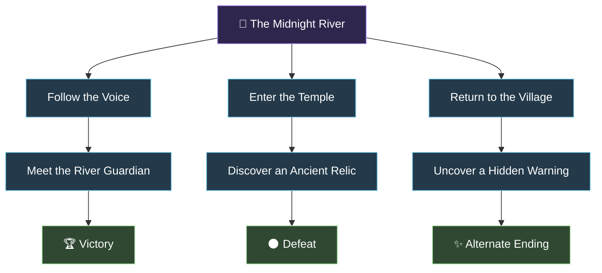
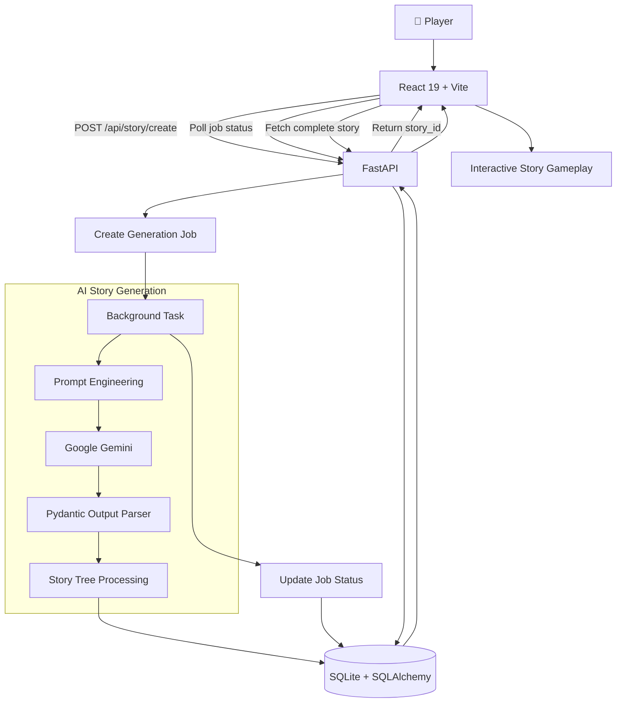

# 🗝️ StoryForge — AI-Powered Branching Adventures

<p align="center">
  <strong>Every choice opens a door. Every door leads to a different destiny.</strong>
  <br />
  An interactive storytelling engine that turns your imagination into playable worlds.
  <br /><br />
  
  
  
  
  
</p>

---

## 🌌 What if your choices could rewrite the story?

Imagine standing beside an ancient river at midnight. A mysterious voice calls your name. Three paths lie before you: follow the voice, investigate the abandoned temple, or return to your village.

There is no predetermined route for you to follow.

**StoryForge** is an AI-powered, choose-your-own-adventure platform that transforms a simple theme into a structured, branching narrative. Instead of merely chatting with an AI about a story, you explore a world through meaningful decisions, uncover alternate paths, and discover how different choices lead to different endings.

From forgotten kingdoms and mythical forests to futuristic civilizations, your next adventure begins with a single idea.

> *The story is written by AI. The destiny is shaped by you.*

## ✨ Enter the Story

<p align="center">
  
  <br />
  <em>01 — The beginning of an adventure.</em>
</p>

### 🎨 I. Imagine a World

Give the engine a theme, setting, or concept. The generation pipeline transforms your idea into a structured narrative with interconnected scenes and meaningful choices.

### 🌿 II. Walk Your Own Path

<p align="center">
  
  <br />
  <em>02 — One story. Multiple possible destinies.</em>
</p>

Every decision moves you to another node in the story graph. Explore alternate routes and experience the consequences of your choices.

### 🏆 III. Discover Your Destiny

<p align="center">
  
  <br />
  <em>03 — Every journey reaches its own conclusion.</em>
</p>

Reach a triumphant victory, encounter an unexpected defeat, or discover a resolution you never anticipated. Restart your adventure or create an entirely new world.

---

## 🌳 Beyond a Chatbot: A Narrative Graph

Most AI storytelling interfaces generate a passage, wait for a response, and generate another passage. StoryForge takes a different approach: **the story is represented as a connected decision graph.**

A generation request produces a structured narrative containing story nodes, available choices, branching paths, and ending states. The application persists that structure so the player can navigate the generated adventure without asking the LLM to rewrite every scene.

Here is a simplified example of what a branching adventure might look like:



*Illustrative example — not a screenshot or a specific story generated by the application.*

This graph-based approach separates **story creation** from **story exploration**, making the generated narrative easier to validate, store, retrieve, and navigate.

## 🧠 The Engineering Behind the Magic

### Structured generation instead of unstructured prose

A language model can write compelling prose, but a playable adventure needs more than good writing. It needs a predictable structure.

StoryForge combines LangChain, Google Gemini, and Pydantic schemas to organize model output into a machine-readable story representation.

The intended narrative structure includes:

- A story title and opening scene.
- Individual nodes containing narrative text.
- Multiple choices connecting scenes.
- Explicit ending states for completed branches.
- A hierarchy that represents the possible progression of the adventure.

Pydantic validation helps ensure the generated response conforms to the expected schema before it is processed further.

### A persistent story, not a disposable response

Generated stories and their individual decision nodes are stored in SQLite through SQLAlchemy.

This provides a persistent representation of the adventure, allowing the application to retrieve the story structure and traverse its branches without regenerating the entire narrative on each choice.

### Job-based generation

Generating a complete branching narrative can take longer than a typical API request.

The backend uses a job-based workflow to separate the initial request from the generation process. The frontend can poll for the job status and retrieve the completed story when it becomes available.

### An immersive experience

The React frontend combines interactive choice cards, custom gradients, atmospheric typography, and animated visual details to make the application feel like a digital storybook rather than a conventional chatbot.

---

## 🏗️ System Architecture



### Request lifecycle

| Stage | Responsibility |
|---|---|
| 01 — Input | The player submits a theme. |
| 02 — Dispatch | FastAPI creates a generation job. |
| 03 — Generate | The background workflow invokes the configured Gemini model through LangChain. |
| 04 — Validate | Pydantic parses the structured response. |
| 05 — Persist | The story and its nodes are saved through SQLAlchemy. |
| 06 — Track | The job status is updated as processing progresses. |
| 07 — Retrieve | The frontend fetches the completed story structure. |
| 08 — Explore | The player navigates the available choices. |

---

## 🛠️ Technology Stack

| Layer | Technologies | Purpose |
|---|---|---|
| Frontend | React 19, Vite | Interactive user interface |
| Navigation | React Router v7 | Client-side routing |
| API communication | Axios | HTTP requests and job polling |
| Backend | FastAPI, Uvicorn | REST API and server execution |
| Generative AI | Google Gemini | Narrative generation |
| LLM orchestration | LangChain | Prompting and structured output parsing |
| Data validation | Pydantic, Pydantic Settings | Schemas and configuration |
| ORM | SQLAlchemy 2.x | Relational data persistence |
| Database | SQLite | Stories, nodes, and job records |
| Styling | Custom CSS3 | Atmospheric visual design |

---

## 📂 Project Structure

```text
Story-Generator/
│
├── assets/
│   ├── landing-page.png
│   ├── interactive-story.png
│   └── story-ending.png
│
├── backend/
│   ├── core/
│   │   ├── config.py              # Application configuration
│   │   ├── models.py              # Structured LLM output models
│   │   ├── prompts.py             # Narrative prompt engineering
│   │   └── story_generator.py     # Generation and tree persistence
│   │
│   ├── db/
│   │   └── database.py            # Database engine and sessions
│   │
│   ├── models/
│   │   ├── job.py                 # Generation job model
│   │   └── story.py               # Story and node models
│   │
│   ├── routers/
│   │   ├── job.py                 # Job status endpoints
│   │   └── story.py               # Story API endpoints
│   │
│   ├── schemas/
│   │   ├── job.py                 # Job request/response schemas
│   │   └── story.py               # Story API schemas
│   │
│   ├── .env.example
│   ├── main.py
│   └── requirements.txt
│
├── frontend/
│   ├── src/
│   │   ├── components/
│   │   │   ├── LoadingStatus.jsx
│   │   │   ├── StoryGame.jsx
│   │   │   ├── StoryGenerator.jsx
│   │   │   ├── StoryLoader.jsx
│   │   │   └── ThemeInput.jsx
│   │   ├── App.jsx
│   │   ├── App.css
│   │   ├── index.css
│   │   ├── main.jsx
│   │   └── util.js
│   ├── package.json
│   └── vite.config.js
│
├── README.md
└── LICENSE
```

---

## 🚀 Bring Your Own Adventure to Life

### Requirements

- Python 3.10+
- Node.js and npm
- A Google Gemini API key from [Google AI Studio](https://aistudio.google.com/)

### 1. Clone the project

```bash
git clone https://github.com/Pratham16CS/Story-Generator.git
cd Story-Generator
```

### 2. Set up the backend

```bash
cd backend
python -m venv venv
```

Activate the virtual environment.

**Windows PowerShell**

```powershell
.\venv\Scripts\Activate.ps1
```

**Linux / macOS**

```bash
source venv/bin/activate
```

Install dependencies:

```bash
pip install -r requirements.txt
```

Create `backend/.env` using `.env.example` as a reference. Configure the variables expected by `backend/core/config.py`.

For example, if these names match your current settings:

```ini
DATABASE_URL=sqlite:///./database.db
API_PREFIX=/api
DEBUG=True
ALLOWED_ORIGINS=http://localhost:5173,http://localhost:3000
GEMINI_API_KEY=your_gemini_api_key
```

**Important:** Keep your real API key private and never commit your `.env` file.

Start the API server:

```bash
uvicorn main:app --reload --host 127.0.0.1 --port 8000
```

Explore the API:

- [Swagger UI](http://localhost:8000/docs)
- [ReDoc](http://localhost:8000/redoc)

### 3. Launch the frontend

Open a second terminal:

```bash
cd frontend
npm install
npm run dev
```

Open the local URL printed by Vite, usually:

[http://localhost:5173](http://localhost:5173)

Make sure the Vite development proxy forwards `/api` requests to the backend running on port `8000`.

---

## 🔌 API at a Glance

### Create a story

`POST /api/story/create`

```json
{
  "theme": "The River's Secret"
}
```

Returns a generation job identifier and its initial status.

### Check generation progress

`GET /api/jobs/{job_id}`

Retrieves the current state of a generation job and, when available, the generated story identifier.

### Retrieve the complete story

`GET /api/story/{story_id}/complete`

Retrieves the stored story structure, including its root node and branching choices.

For exact response schemas, validation rules, and error responses, use the running FastAPI documentation at `/docs`.

---

## 🔭 The Next Chapter

The current foundation opens the door to several possible extensions:

- [ ] 🎨 **Living Story Worlds** — Generate atmospheric illustrations for individual scenes.
- [ ] 🔊 **A Voice for Every Story** — Add text-to-speech narration.
- [ ] 🎒 **Player State & Inventory** — Introduce health, items, attributes, and skill checks that influence available choices.
- [ ] 🧭 **Consequential Choices** — Track previous decisions and use them to affect later branches.
- [ ] 👥 **Shared Adventures** — Allow multiple players to vote on decisions.
- [ ] 🧪 **Narrative Quality Evaluation** — Test branch completeness, reachability, consistency, and ending coverage.
- [ ] ⚙️ **More Robust Generation** — Add retries, timeouts, and recovery for invalid or incomplete model output.

---

## 🤝 Contribute to the Story

Have an idea for a new narrative mechanic, an improvement to the generation pipeline, or a better way to explore branching stories?

Contributions are welcome.

1. Fork the repository.
2. Create a branch: `git checkout -b feature/your-feature`.
3. Commit your changes: `git commit -m "Add your feature"`.
4. Push your branch: `git push origin feature/your-feature`.
5. Open a pull request.

## 📜 License

Distributed under the MIT License. See [`LICENSE`](LICENSE) for details.

---

<p align="center">
  <strong>Not every path leads to victory. That's what makes the adventure worth taking.</strong>
  <br /><br />
  Built with curiosity, code, and a little bit of magic.
  <br />
  <a href="https://github.com/Pratham16CS/Story-Generator">Explore the repository on GitHub</a>
</p>
